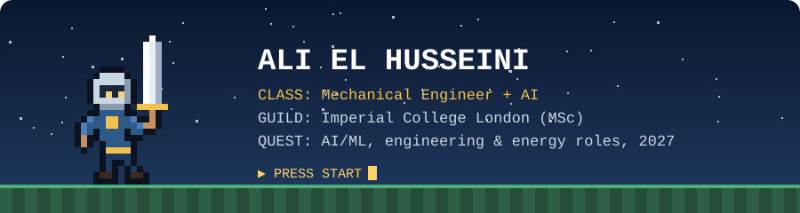

<p align="center">
  
</p>

<h3 align="center">⚔️ Player 1: Ali &nbsp;|&nbsp; Mechanical Engineer turned AI builder ⚔️</h3>

<p align="center">
  <a href="https://www.linkedin.com/in/ali-el-husseini-b18ba3222"></a>
  <a href="mailto:AEH.02@outlook.com"></a>
</p>

---

### 🧙 Character sheet

```text
PLAYER    Ali El Husseini
CLASS     Mechanical Engineer + AI
GUILD     Imperial College London, MSc Renewable Energy with AI & Data Science
BASE      London, UK

STATS
  Python ............ ████████░░
  LLM evaluation .... █████████░
  C++ ............... ██████░░░░
  Engine repair ..... ████████░░
  Stamina (gym 5x/wk) █████████░
```

### 📜 Quest log

| Status | Quest | Reward |
|:--:|---|---|
| ✅ | **The Model Whisperer**: 3 years evaluating frontier LLMs, including Anthropic's Claude | Rubric design, adversarial prompting, Python validation |
| ✅ | **The Garage Grind**: bought, repaired and resold 55+ cars since 2022 | Diagnostics, sourcing parts, negotiation |
| ✅ | **Wind Tamer**: built a wind farm wake model package (Jensen model) | NumPy, pytest, profiling |
| ✅ | **Dungeon Builder**: 4,500+ line text RPG in C++ | OOP, finite-state logic, XML loading |
| 🔄 | **Main Quest**: MSc at Imperial | Expected May 2027 |
| 🔍 | **Seeking party**: AI/ML, engineering or energy data roles | Summer 2027 or graduate entry |

### 🎒 Inventory


### 🥋 Side quests

- 2nd Dan black belt in Shotokan karate, training since age 7
- Member of Imperial College Judo Society

<p align="center"><i>▶ Want to team up? Send a party invite on LinkedIn.</i></p>
